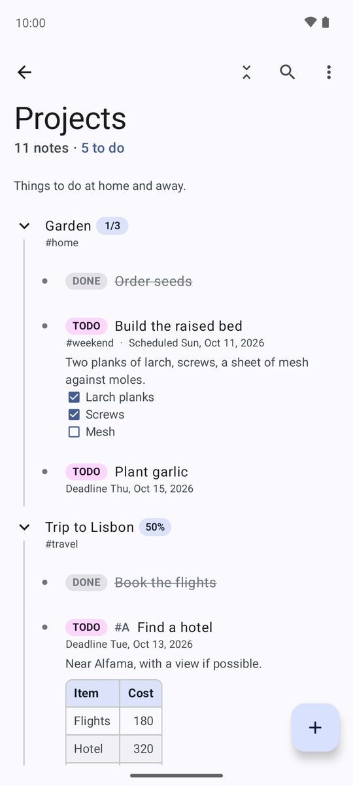
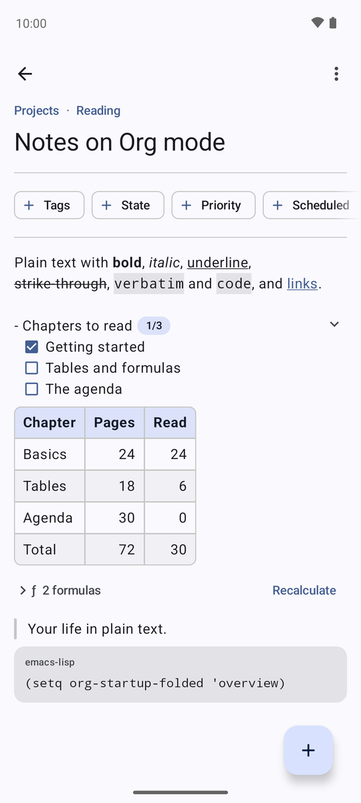
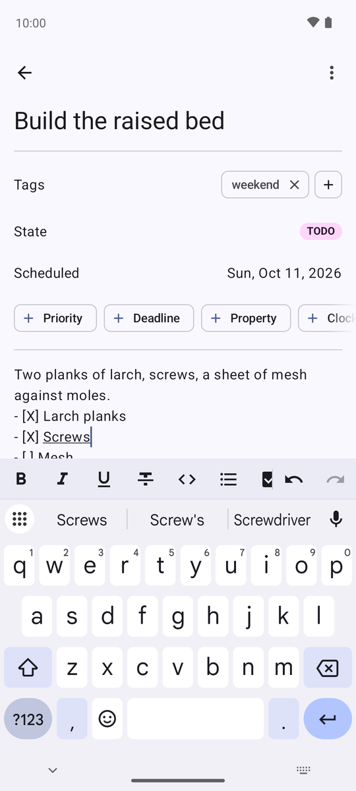
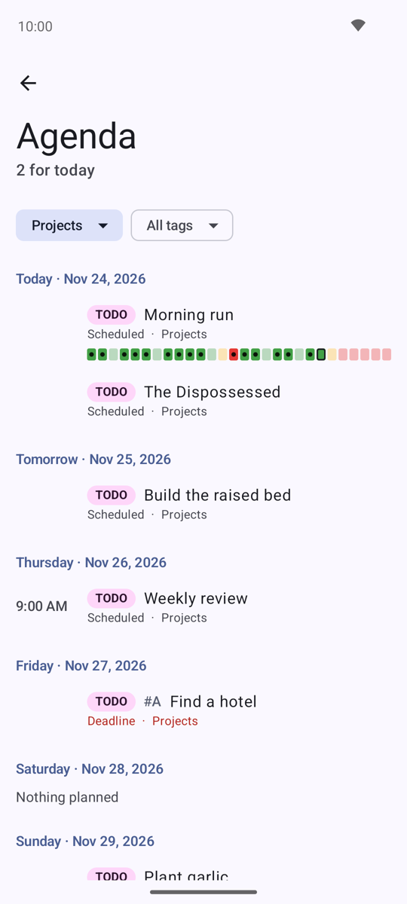

# Orgwhal


An Android app for [Org mode](https://orgmode.org) notes, inspired by
[Orgzly](https://github.com/orgzly/orgzly-android). It reads and writes your `.org` files directly:
there is no database, and the same files open in Emacs.

<p>
  
  
  
  
</p>

## Getting started

1. Install the APK from the latest [release](https://github.com/yighy/orgwhal/releases).
2. Pick the folder that holds your `.org` files. Each file is a notebook, and each heading is a note.
3. Add the guide notebook when Orgwhal offers it. Each of its notes explains a feature and is an
   example to try. You can add it again later from *Settings → About*.

Files changed by another app, or synced from another device, are read again within seconds. The
parts of a file that Orgwhal doesn't change stay exactly as they were.

## Features

### Notebooks and notes
- Notebooks fold as in Org (`#+STARTUP`, the `VISIBILITY` property) and reopen as you left them.
- While you scroll, the titles of the parent notes stay at the top.
- A tree view draws a notebook as boxes that you can move, zoom and rearrange.
- Select several notes to move, copy, refile, archive or delete them, with undo.

### Writing
- A toolbar over the keyboard for bold, italic, code, lists, checkboxes, indents, links and dates.
- Checkboxes, and progress counters on parent notes (`[1/3]` and `[50%]` cookies).
- Code, quote and example blocks, and drawers.
- Template notes: a note tagged `:template:` starts new ones, with `%u`, `%U`, `%t` and `%T`
  filled in as in capture templates.

### Links between notes
- Type `id:` or `[[`, then pick a note, a target or a named table from the suggestions.
- Links follow a note when it is renamed, and a link to a missing note offers to create it.
- Each note lists the notes that link to it.
- A `#+transclude:` line shows another note's content, a table or a paragraph in place, as
  org-transclusion does.

### Tables
- Tap a field to edit it in place; the table realigns as Emacs writes it.
- Column and field formulas (`#+TBLFM`), recalculated on demand as `C-c C-c` does.
- `remote()` reads a field of another named table, even in another note.

### Agenda and reminders
- The agenda shows overdue tasks, then today and the next six days, including repeating tasks.
- Habits (`STYLE: habit`) are drawn as org-habit's consistency graph.
- Reminders ring at scheduled and deadline times. From the notification you can mark the note
  done, snooze it or start its clock.

### Time tracking
- Clock in and out of a note. Clocks are written to its `:LOGBOOK:` as in Emacs.
- A notification shows the running clock, with *Stop* and *Done* buttons.
- A time report sums the time spent by notebook and note, as Org's clocktable does.
- Pomodoros can be turned on in the settings.

### Search
- Search for words or with Orgzly's syntax: `it.todo`, `t.work`, `s.today`, `o.p`…
- Searches can be saved and run again from the menu.

### Archiving
- Archive a note to the notebook's `_archive` file, with the same properties as Emacs
  (`C-c C-x C-s`). The `ARCHIVE` tag (`C-c C-x a`) is supported too.
- Archived notes can still be found by a link or a search, and put back where they were.

### Sharing
- Share a page from another app (a browser, for example) to Orgwhal: it becomes a note in an
  *Inbox* notebook, which you can then move to another notebook.

## Requirements

- Android 8.0 (API 26) or later.

## Download

Signed APKs are attached to each [release](https://github.com/yighy/orgwhal/releases). See
[CHANGELOG.md](CHANGELOG.md) for what changed.

## Build

Requires JDK 17+ and the Android SDK (platform 37).

```bash
./gradlew :app:testDebugUnitTest :app:assembleDebug
```

Release builds are signed when a `keystore.properties` file at the project root (kept out of
git) gives `storeFile`, `storePassword`, `keyAlias` and `keyPassword`.

## License

GPLv3. Includes a copy of [org-java](https://github.com/orgzly/org-java) (GPLv3), see
[org-java/README.md](org-java/README.md).
